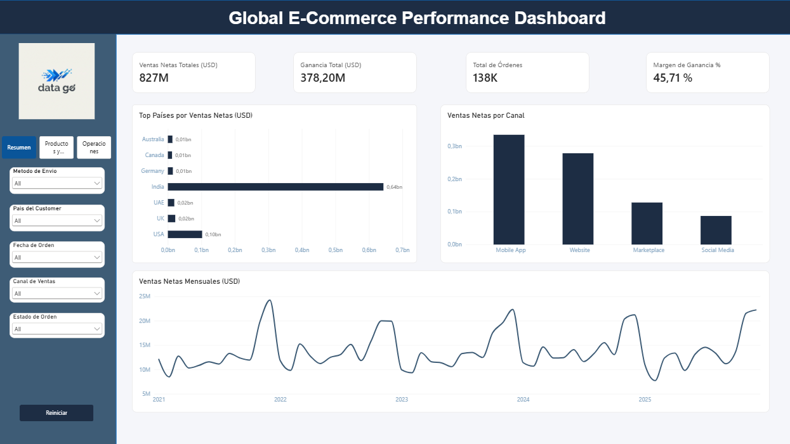
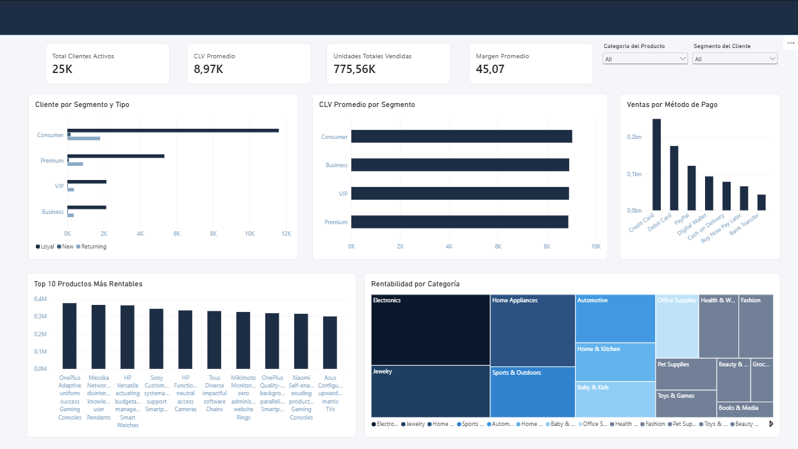
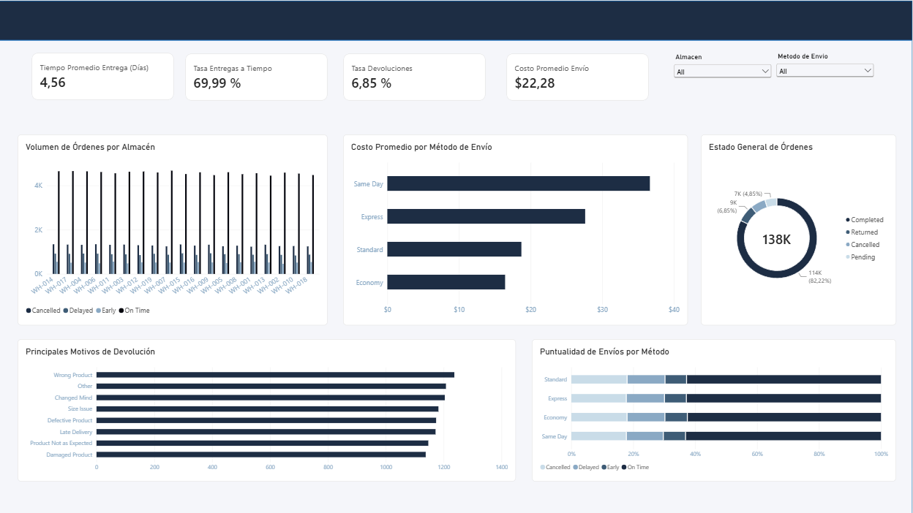

# E-Commerce Analytics & Operations Intelligence

> ¡Hola! Este repositorio muestra el desarrollo de una solución integral de Business Intelligence y Análisis de Datos para un e-commerce global. El proyecto cubre todo el ciclo de vida del dato: desde la limpieza y preparación inicial en Python hasta el diseño de un dashboard interactivo en Power BI enfocado en la toma de decisiones gerenciales.

---

## Tabla de Contenidos
- [Descripción del Proyecto](#descripción-del-proyecto)
- [Arquitectura y Pipeline de Datos](#arquitectura-y-pipeline-de-datos)
- [Estructura del Dashboard (Power BI)](#estructura-del-dashboard-power-bi)
- [Preguntas Clave Resueltas](#preguntas-clave-resueltas)
- [Tecnologías Utilizadas](#tecnologías-utilizadas)
- [Autor](#autor)

---

## Descripción del Proyecto
Este repositorio contiene un pipeline analítico integral diseñado para transformar datos transaccionales y logísticos sin procesar en métricas de negocio de alto impacto. El sistema evalúa el comportamiento general del negocio, la rentabilidad de las categorías, el desempeño de los clientes y la eficiencia logística, ofreciendo una interfaz visual moderna bajo un diseño corporativo de tema oscuro.

---

## Arquitectura y Pipeline de Datos

El flujo de trabajo se divide en dos grandes etapas técnicas:

1. **Preprocesamiento y Limpieza (Python / Pandas):**
   * Procesamiento de datasets relacionales (maestro de clientes, detalles de ítems de órdenes y métricas de envío) ubicados en la carpeta `notebooks/`.
   * Limpieza de valores nulos, estructuración de tipos de datos y unificación de tablas mediante identificadores únicos (`customer_id`, `order_id`, etc.).
   * Generación de variables derivadas para el análisis de costos, márgenes de ganancia y tiempos de entrega.

2. **Modelado y Visualización (Power BI):**
   * Modelado relacional optimizado en estrella.
   * Creación de medidas y cálculos avanzados para el seguimiento dinámico de KPIs clave.

---

## Estructura del Dashboard (Power BI)

El reporte interactivo cuenta con tres páginas principales orientadas a la toma de decisiones gerenciales:

### 1. Resumen (Overview)
* **Vista Ejecutiva Global:** Panel principal con los indicadores generales de ventas, ingresos netos, volumen total de órdenes y métricas clave de salud financiera y comercial del e-commerce para una lectura rápida a nivel gerencial.

> **Vista previa - Resumen:**
> 

### 2. Productos y Clientes
* **Cartera de Clientes:** Segmentación demográfica y por tipo de usuario (*Consumer, Premium, VIP*).
* **Valor de Vida del Cliente (CLV):** Métricas de valor aportado por segmento.
* **Top de Productos Rentables:** Artículos con mayor margen de ganancia neta.
* **Rentabilidad por Categoría:** Mapa de árbol (*Treemap*) interactivo con paleta monocromática de azules corporativos.
* **Preferencias de Pago:** Análisis de métodos de pago más utilizados.

> **Vista previa - Productos y Clientes:**
> 

### 3. Operaciones y Logística
* **Eficiencia de Almacenes:** Monitoreo del volumen de órdenes despachadas y cumplimiento de entregas (`delivery_status`).
* **Tiempos y Costos de Envío:** Control del tiempo promedio de entrega (en días) y costo logístico por tipo de servicio (*Standard, Express, Economy, Same Day*).
* **Salud Operativa:** Distribución porcentual del estado general de las órdenes.
* **Gestión de Devoluciones:** Identificación de los principales motivos de devolución de mercancía (`return_reason`).

> **Vista previa - Operaciones:**
> 

---

## Preguntas Clave Resueltas por el Análisis

Este proyecto de análisis de datos da respuesta directa a las siguientes preguntas estratégicas de negocio:

1. ¿Cuáles son los niveles generales de ventas, ingresos netos y volumen total de transacciones del e-commerce?
2. ¿Quiénes son los clientes que más aportan al negocio y cómo se segmentan (*Consumer, Premium, VIP*)?
3. ¿Cuál es el Valor de Vida del Cliente (*Customer Lifetime Value - CLV*) por cada segmento?
4. ¿Cuáles son los productos y categorías que generan mayor margen de ganancia neta?
5. ¿Cuáles son los métodos de pago más utilizados por los compradores en la plataforma?
6. ¿Qué almacenes procesan mayor volumen de órdenes y cuál es su estado de cumplimiento (*delivery_status*)?
7. ¿Cuánto tiempo en promedio (en días) toma entregar un pedido a los clientes?
8. ¿Cuál es el costo logístico promedio por cada tipo de método de envío (*Standard, Express, Economy, Same Day*)?
9. ¿Qué porcentaje de las órdenes totales se entregan a tiempo o con retraso?
10. ¿Cuáles son los motivos principales por los cuales los clientes devuelven los productos (*return_reason*)?

---

## Tecnologías Utilizadas
* **Python (Pandas, Jupyter Notebooks):** Limpieza, wrangling y normalización de datasets.
* **Power BI Desktop:** Modelado tabular, desarrollo de medidas y diseño de interfaces visuales (UI/UX).
* **Git & GitHub:** Control de versiones y despliegue del proyecto.

---